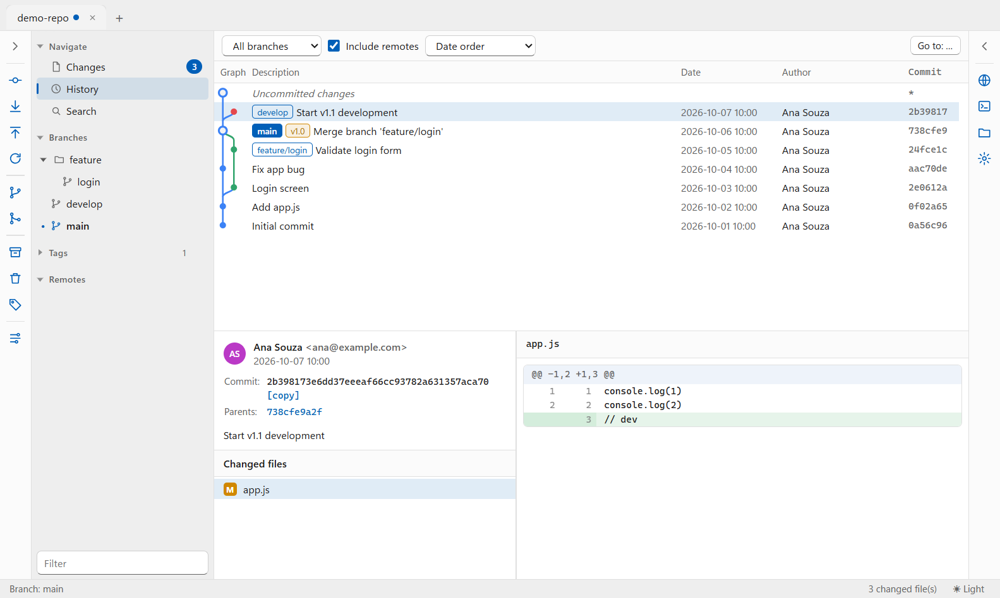

[English](README.md) · [Português (BR)](README.pt-BR.md) · [Español](README.es.md)

# EasySource

A modern, multiplatform visual Git client for **Windows, macOS and Linux**.

Repository tabs, commit graph, split staging with hunk and line selection, and
dialogs for every day-to-day Git operation — built with Electron, Node.js and
plain HTML5/CSS/JavaScript, on top of the Git command line.

<picture>
  <source media="(prefers-color-scheme: dark)" srcset="docs/screenshot-dark.png">
  
</picture>

## Features

- **Repository tabs:** bookmarks, clone (branch, depth, submodules), add existing, create new
- **Changes:** staged and unstaged panes, stage/unstage/discard by file, hunk or selected lines,
  filters (pending, conflicts, untracked, modified, ignored), keyboard shortcuts (+, −, Del)
- **Commit:** amend, sign-off, skip hooks, push immediately after committing
- **History:** commit graph with branch and tag labels, date or topological order, all or current branch,
  jump to commit, commit details and diff
- **Search:** by commit message, author, file content changes or file path
- **Sync:** fetch, pull (merge or rebase) and push with per-branch selection and tracking,
  with a live progress window
- **Branches and tags:** create, delete, rename, checkout (local or remote), merge, rebase,
  interactive rebase (reorder, squash, fixup, drop)
- **Commits:** reset (soft, mixed, hard), revert, cherry-pick, create patch, archive
- **More:** stashes, conflict resolution, Git flow, blame, submodules, remotes, `.gitignore`,
  per-repository identity
- Light/dark theme (follows the system or set manually)

The interface is available in English, Portuguese (Brazil), Spanish, Simplified Chinese,
Japanese, German, French, Korean and Russian. It follows the system language and can be
changed in Tools > Options. Git terms (commit, push, merge…) stay in English.

## Download

Get the latest version on the [Releases](https://github.com/RogerPhilippe/EasySource/releases) page:

| System | File |
|---|---|
| Windows x64 (installer) | `EasySource-Setup-<version>-x64.exe` |
| Windows x64 (portable) | `EasySource-<version>-win-x64.zip` |
| macOS (Apple Silicon) | `EasySource-<version>-mac-arm64.dmg` |
| macOS (Intel) | `EasySource-<version>-mac-x64.dmg` |
| Linux x64 | `EasySource-<version>-linux-x64.AppImage`, `.deb` or `.tar.gz` |

[Git](https://git-scm.com/downloads) must be installed and available in `PATH`.

The builds are not signed, so the system shows a warning on first launch:

- **Windows:** in the SmartScreen warning, click **More info → Run anyway**.
- **macOS:** right-click the app → **Open**, or run
  `xattr -dr com.apple.quarantine /Applications/EasySource.app`.
- **Linux (AppImage):** run `chmod +x EasySource-*.AppImage` first.

## Running locally

Requirements: Node.js 20+ and Git

```bash
npm install
node node_modules/electron/install.js   # only if npm blocked Electron's install script
npm start                               # or: npm start -- C:\path\to\repo
```

## Testing

```bash
npm test             # Git layer and commit graph, against real temporary repositories
npm run test:smoke   # opens the app on a sample repository and checks for errors
```

## Building the app

```bash
npm run icon         # regenerates the icons from assets/icon.svg
npm run dist         # builds for the current system into dist/
npm run dist:win     # or a single platform: dist:win, dist:mac, dist:linux
```

Each platform is built on its own system (macOS packages require macOS).
The GitHub Actions workflows build all three: `CI` on every push, and
`Release` when a `v*` tag is pushed, publishing the packages as a release.

The macOS app gets an ad-hoc signature. To distribute without Gatekeeper or
SmartScreen warnings, sign with a Developer ID (macOS) or a code-signing
certificate (Windows).

## Project structure

```
src/main/        main process (Node.js)
  main.js        window, IPC, file watcher
  git.js         Git command-line wrapper and output parsers
  menu.js        application menu
  store.js       bookmarks, open tabs and preferences
src/preload.js   secure bridge between main process and UI
src/i18n.js      language selection and translation lookup
src/locales/     UI translations (one JSON per language; English is the source)
src/renderer/    interface (HTML5, CSS, JavaScript)
  js/repo.js     repository tab: side rails, sidebar and views
  js/status.js   changes and commit
  js/history.js  history, search and commit details
  js/actions.js  Git operation dialogs
assets/          app icon (SVG source, PNG, ICO)
.github/         CI and release workflows (Windows, macOS, Linux)
```

## Stack

Electron · Node.js · Git CLI · HTML5 · CSS · JavaScript — no runtime dependencies.

## License

EasySource is distributed under a **dual license**:

- [AGPLv3](LICENSE) — free for any use, including commercial use, as long as
  anyone who receives the software (or uses a modified version over a
  network) also gets the complete source code under the same license.
- [Commercial license](COMMERCIAL-LICENSE.md) — a safeguard, not a product:
  only needed to use EasySource in closed-source or proprietary ways, and
  granted solely at the maintainer's discretion.

### What you can do

| Use | Allowed? |
|---|---|
| Use EasySource personally or at work, including in companies | Yes, free |
| Study, modify and build your own version | Yes, free |
| Redistribute or sell copies, original or modified, together with the complete source code under the AGPLv3 | Yes, free (AGPLv3) |
| Offer a modified version as a network service | Yes, if the modified source is published under the AGPLv3 |
| Sell or distribute it as closed source, or embed it in proprietary software | Only with a commercial license from the maintainer |

This table is a summary for convenience; the [LICENSE](LICENSE) text prevails.

### Third-party software

The packages include Electron, Chromium and Node.js under their own licenses
(MIT, BSD-3-Clause and others), shipped alongside the app as
`LICENSE.electron.txt` and `LICENSES.chromium.html`. EasySource has no other
runtime dependencies; build tools such as electron-builder are not included
in the app.

Contributions are subject to the terms in [CONTRIBUTING.md](CONTRIBUTING.md).
To report a security problem, see [SECURITY.md](SECURITY.md).

Copyright © 2026 Roger Philippe Pereira
